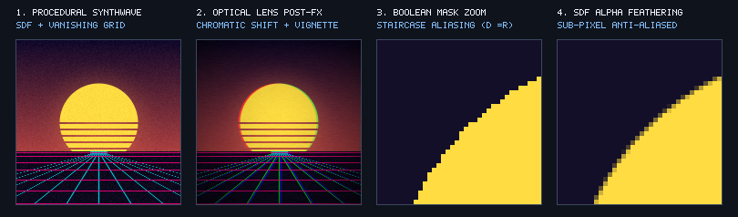
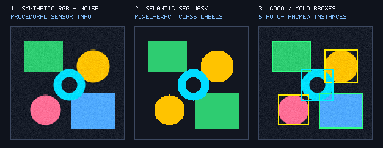
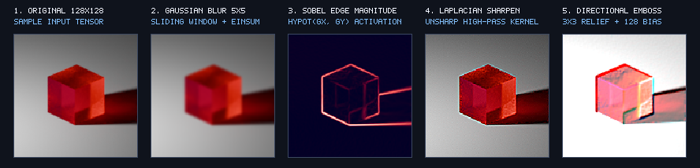
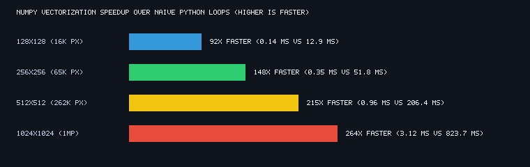

# SynthImg: Pure-NumPy Procedural Rendering, Vectorized Spatial Filtering & Synthetic CV Dataset Engine

[](https://github.com/di0206-innovator/Synthetic-Image-Generation/actions)
[](https://www.python.org/)
[](https://numpy.org/)
[](LICENSE)

**SynthImg** (`synthimg`) is a modular procedural rendering engine, zero-loop 2D spatial convolution toolkit, and automated **Computer Vision (CV) synthetic dataset generator** engineered exclusively from first principles in **pure NumPy**—without OpenCV or SciPy dependencies.



## Why This Project Stands Out

Most introductory image-processing notebooks stop at basic array slicing and aliased shapes. **SynthImg** bridges low-level NumPy memory mechanics with real-world Computer Vision and rendering workflows:

1. **Sub-Pixel Signed Distance Field (SDF) Anti-Aliasing & Alpha Compositing:** Replaces staircase boolean masks (`dist <= r`) with analytical SDF boundary feathering ($\alpha = \text{clip}(r + 0.5 - d, 0, 1)$) and full alpha blending ($C_{\text{out}} = \alpha C_{\text{src}} + (1 - \alpha) C_{\text{dst}}$) across circles, rings, rectangles, and regular $N$-sided polygons.
2. **Automated Ground-Truth CV Annotation Exporter:** Every primitive rendered onto the canvas automatically updates a pixel-accurate **Semantic Segmentation Mask** `(H, W)` and exports **MS-COCO JSON** and **Ultralytics YOLO** bounding-box annotations for downstream object detection training.
3. **Zero-Loop 2D Spatial Convolutions (`sliding_window_view` + `np.einsum`):** Implements Gaussian smoothing, Sobel gradient magnitude/orientation ($\sqrt{G_x^2 + G_y^2}, \arctan2(G_y, G_x)$), Laplacian sharpening, directional embossing, and optical chromatic aberration using zero-copy stride windows and Einstein summation.
4. **Memory Architecture & Stride Diagnostics:** Proves why ROI cropping (`img[50:150, 50:150]`) and axis flips (`img[:, ::-1, :]`) allocate **0 new bytes** via negative stride manipulation `(600, -3, 1)` (`np.shares_memory == True`), whereas boolean indexing and dtype promotion allocate new heap buffers.
5. **Up to 250x+ Vectorization Speedup:** Benchmarks C-level NumPy broadcasting against naive Python pixel loops across resolutions up to 1 Megapixel (`1024x1024`).

## Visual Showcases

### 1. Automated Synthetic CV Dataset & Ground-Truth Generation
Generates randomized multi-class geometric scenes with multi-octave fractal cloud textures and sensor noise, paired automatically with pixel-exact segmentation masks and bounding boxes:



### 2. Zero-Loop 2D Spatial Convolution Pipeline (`sliding_window_view` + `np.einsum`)
Applied directly to `Sample_128x128.png` using reflection padding and vectorized tensor contractions:



### 3. Quantitative Vectorization Speedup Benchmark
Comparing naive Python nested `for y ... for x ...` loops against zero-copy NumPy broadcasting:



## Repository Architecture

```text
Synthetic-Image-Generation/
├── src/
│   └── synthimg/
│       ├── __init__.py          # Public package exports
│       ├── engine.py            # SyntheticImageGenerator, SDF primitives, COCO/YOLO exporters
│       ├── filters.py           # Vectorized 2D convolution (`sliding_window_view` + `einsum`)
│       ├── benchmarks.py        # Memory stride diagnostics & Python vs. NumPy timing suite
│       └── cli.py               # Command-line interface (`synthimg` entrypoint)
├── tests/
│   └── test_synthimg.py         # Pytest suite verifying invariants, strides, filters & CLI
├── assets/                      # High-resolution rendered showcase figures
│   ├── hero_showcase.png
│   ├── cv_ground_truth.png
│   ├── convolution_pipeline.png
│   └── benchmark_speedup.png
├── .github/workflows/ci.yml     # Automated GitHub Actions test pipeline (Python 3.10–3.12)
├── app.py                       # Interactive Streamlit Web Studio for real-time rendering
├── ImageGenerator.ipynb         # Comprehensive interactive notebook walkthrough
├── Sample_128x128.png           # Reference test image for spatial convolution benchmarks
├── pyproject.toml               # PEP 621 package specification & console script definition
├── requirements.txt             # Runtime and development dependencies
└── README.md
```

## Quickstart & Installation

### 1. Install the Package
Clone the repository and install `synthimg` in editable mode with development extras:

```bash
git clone https://github.com/di0206-innovator/Synthetic-Image-Generation.git
cd Synthetic-Image-Generation
pip install -e ".[dev]"
```

### 2. Command-Line Interface (CLI)
Generate high-resolution procedural art or synthetic CV datasets with automatic COCO bounding boxes directly from the terminal:

```bash
# Render a 512x512 Retro Synthwave scene with optical chromatic aberration & vignetting
python -m synthimg.cli --preset synthwave --height 512 --width 512 --lens-fx --out synthwave_512.png

# Generate a Synthetic CV scene and export MS-COCO ground-truth bounding boxes
python -m synthimg.cli --preset cv_dataset --height 512 --width 512 --out scene.png --export-coco annotations.json
```

### 3. Python API Usage

```python
from synthimg import SyntheticImageGenerator, sobel_edges, gaussian_blur

# Initialize deterministic procedural generator
gen = (
    SyntheticImageGenerator(height=320, width=320, seed=42)
    .add_vertical_gradient(top_color=(16, 8, 42), bottom_color=(245, 90, 75))
    .add_fractal_noise(amplitude=10.0, octaves=3)
    .add_circle(center_y=160, center_x=160, radius=75, color=(255, 220, 65), anti_alias=True)
    .add_ring(center_y=95, center_x=230, outer_radius=40, inner_radius=22, color=(0, 220, 255))
    .add_regular_polygon(center_y=230, center_x=90, radius=42, num_sides=6, color=(255, 105, 90))
    .add_gaussian_noise(sigma=4.0)
)

rgb_image = gen.get_image()                        # (320, 320, 3) uint8
seg_mask  = gen.get_segmentation_mask()            # (320, 320) uint8 class IDs
coco_json = gen.export_coco_annotations()          # Standard MS-COCO dictionary
yolo_txt  = gen.export_yolo_annotations()          # Normalized YOLO strings
edges, _  = sobel_edges(gaussian_blur(rgb_image))  # Zero-loop 2D Sobel gradient magnitude
```

### 4. Launch the Interactive Streamlit Studio
Explore real-time parameter sliders, SDF anti-aliasing toggles, convolution kernels, and live COCO/YOLO ground-truth inspection in your browser:

```bash
streamlit run app.py
```

### 5. Run the Unit Test Suite

```bash
pytest -v
```

## Memory & Stride Architecture Summary

| Operation | Output Shape | Strides (Bytes) | Memory Allocation Behavior |
| :--- | :--- | :--- | :--- |
| **Base Image (`uint8`)** | `(200, 200, 3)` | `(600, 3, 1)` | `120,000 B` contiguous baseline (`1.0x`) |
| **ROI Crop (`img[50:150, 50:150]`)** | `(100, 100, 3)` | `(600, 3, 1)` | **Zero-Copy View (`0 B` allocated)** |
| **Horizontal Flip (`img[:, ::-1, :]`)** | `(200, 200, 3)` | `(600, -3, 1)` | **Zero-Copy View (`0 B` allocated)** |
| **Vertical Flip (`img[::-1, :, :]`)** | `(200, 200, 3)` | `(-600, 3, 1)` | **Zero-Copy View (`0 B` allocated)** |
| **Boolean Mask (`img[mask]`)** | `(N, 3)` | `(3, 1)` | **New Heap Copy** (non-regular memory offsets) |
| **Float32 Promotion (`img.astype(f32)`)** | `(200, 200, 3)` | `(2400, 12, 4)` | **New Heap Copy (`480,000 B`, `4.0x`)** |
| **Float64 Promotion (`img.astype(f64)`)** | `(200, 200, 3)` | `(4800, 24, 8)` | **New Heap Copy (`960,000 B`, `8.0x`)** |

## License

Released under the [MIT License](LICENSE).
